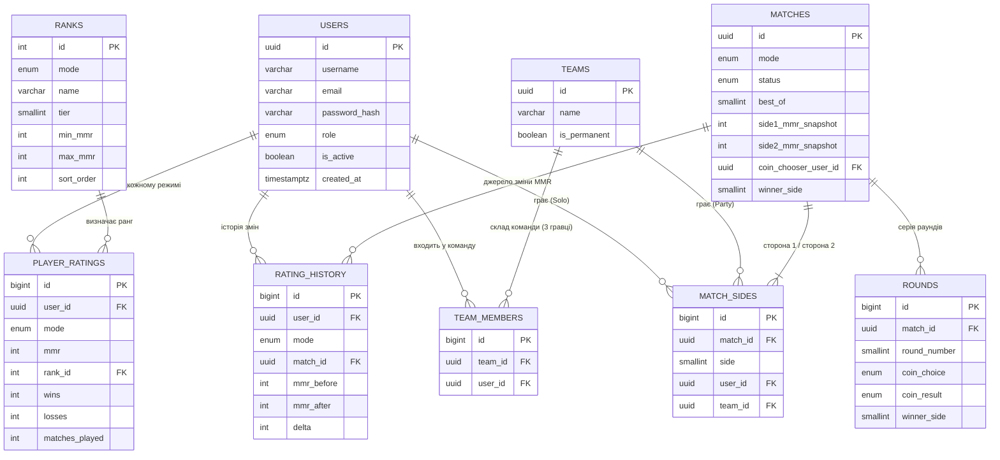

# Орел/Решка - MMR & Matchmaking

База даних та бекенд-скелет (FastAPI + SQLAlchemy + PostgreSQL) для системи
рейтингів і матчмейкінгу гравців у грі "Орел/Решка": Solo MMR (1х1) та
Party MMR (3х3), з системою рангів (Bronze/Silver/Gold — рівні 1-3, Diamond —
топ-ранг зі світовим рейтингом).

## ER-діаграма



## Ключові рішення дизайну

- **Окремий MMR на режим.** Таблиця `player_ratings` має унікальний ключ
  `(user_id, mode)` — у гравця одночасно існує запис для `solo` і для `party`
  зі своїм MMR, статистикою перемог/поразок та рангом.
- **Універсальна модель матчу.** `match_sides` описує обидві сторони матчу
  однаково для Solo (через `user_id`) і Party (через `team_id`) — це дозволяє
  використовувати одну таблицю `matches`/`rounds` для обох режимів замість
  дублювання схеми.
- **Команда = рівно 3 гравці** (перевіряється і на рівні API, і потенційно
  тригером/CHECK у БД за потреби). Команда може бути одноразовою (під один
  матч) або постійним "паті" (`is_permanent = true`).
- **Право вибору сторони монети** зберігається в `matches.coin_chooser_user_id`
  і визначається на старті матчу як гравець (або представник команди) зі
  стороною нижчого MMR — реалізовано в `services/match_service.py`.
- **Матч = серія раундів "Орел/Решка"** до 2 перемог (`best_of = 3`).
  Кожен раунд фіксує вибір (`coin_choice`) і фактичний результат
  (`coin_result`); сторона, що обирала, перемагає в раунді, якщо вибір
  співпав з результатом.
- **Розрахунок MMR — Elo-подібна формула** (`services/elo.py`): чим більша
  різниця рейтингів на користь переможеного суперника, тим більше очок
  отримує переможець і тим менше втрачає той, хто програв сильнішому. Для
  Party MMR порівнюються сумарні MMR команд (масштаб формули множиться на
  розмір команди).
- **Ранги з рівнями.** Довідник `ranks` містить Bronze/Silver/Gold з тирами
  1–3 та єдиний топ-ранг Diamond (без верхньої межі MMR). Ранг гравця
  перераховується після кожного матчу (`services/rank_service.py`).
- **Світовий рейтинг для Diamond.** Позиція обчислюється SQL-віконною
  функцією `RANK() OVER (ORDER BY mmr DESC)` (`crud/rating.py`,
  `get_world_rank_position`) і повертається в API лише якщо поточний ранг
  гравця — Diamond (`routers/users.py`).
- **Історія рейтингу.** Кожна зміна MMR пишеться в `rating_history`
  (before/after/delta, прив'язка до матчу) — це дає повний аудит і основу
  для графіків динаміки рейтингу на фронтенді.

## Архітектурний шаблон (Model / View / Controller)

Проєкт - REST API (FastAPI) + окремий SPA-фронтенд, а не серверний
Flask-шаблон з прикладу вимог, але поділ на Model/View/Controller
дотримано так само чітко, просто в інших теках:

| Шар MVC | Де саме |
|---|---|
| **Model** (дані) | `app/models/` (SQLAlchemy ORM-класи, дзеркалять `sql/schema.sql`) + `app/schemas/` (Pydantic - форма запитів/відповідей) |
| **View** (інтерфейс) | окремий фронтенд: `index.html` + `styles.css` + `app.js` - усі форми CRUD, рендер профілю/матчу/лідерборду |
| **Controller / Logic** | `app/routers/` (приймають HTTP-запит, викликають бізнес-логіку) + `app/services/` і `app/crud/` (сама бізнес-логіка: розрахунок MMR, створення матчу, валідація) |

Контролер і фронтенд спілкуються через JSON (REST), а не через
серверний рендеринг HTML-шаблонів - це свідомий вибір стеку (FastAPI +
SPA), дозволений вимогами ("вибір технологій - за студентом").

## Ролі та авторизація

Є дві ролі, як і вимагається: `user` (звичайний гравець) та `admin`.
Оскільки в застосунку немає токенів/сесій (усі сутності й так
ідентифікуються прямими UUID), розмежування прав реалізоване так само -
через `requester_id`, який передає викликач і який сервер перевіряє:

- Деактивувати акаунт (`DELETE /users/{id}`) може сам власник
  (`requester_id == id`) **або** будь-який `admin`.
- `POST /users/{id}/reactivate`, `/promote`, `/demote` - лише для `admin`.
- Адмін не може зняти права адміністратора сам із себе (щоб система не
  лишилась без жодного адміна).

У `sql/dump.sql` користувач `arthur` створений одразу з роллю `admin`
(демонстраційні дані для першого запуску/захисту).

## Структура проєкту

```
mmr_project/
├── sql/
│   ├── schema.sql          # DDL: усі таблиці, enum-и, зв'язки, індекси
│   ├── seed_ranks.sql      # довідник рангів (Bronze I-III … Diamond)
│   ├── dump.sql            # ПОВНИЙ дамп: schema.sql + seed_ranks.sql + приклад даних
│   └── crud_examples.sql   # приклади "чистого" SQL CRUD (без ORM) + BEGIN/ROLLBACK
├── app/
│   ├── database.py         # engine/session (SQLAlchemy)
│   ├── models/              # ORM-моделі (дзеркалять schema.sql)
│   ├── schemas/              # Pydantic-схеми запитів/відповідей
│   ├── services/
│   │   ├── elo.py            # формула розрахунку зміни MMR
│   │   ├── rank_service.py   # визначення рангу за MMR
│   │   └── match_service.py  # створення/скасування/видалення матчів, раунди
│   ├── crud/                 # CRUD-операції (users, teams, rating)
│   ├── routers/               # FastAPI-ендпоінти
│   └── main.py                # збірка застосунку
├── scripts/
│   └── transaction_demo.py   # наочна демонстрація транзакції з ROLLBACK
├── tests/
│   ├── conftest.py           # ізоляція тестів (SAVEPOINT + rollback)
│   └── test_crud.py          # 6 сценаріїв CRUD (позитивні/негативні)
├── requirements.txt
├── requirements-dev.txt      # + pytest, httpx (для тестів)
└── .env.example
```

## Запуск через Docker Compose (найпростіше)

Не потрібно встановлювати Python, PostgreSQL чи створювати ролі вручну —
все піднімається однією командою:

```bash
docker compose up
```

Це підніме два контейнери:
- `db` — PostgreSQL 16, і при **першому** старті (порожній volume) автоматично
  виконає `sql/dump.sql` — тобто база одразу матиме структуру й приклад даних
  (8 demo-гравців, 2 команди, 2 завершені матчі).
- `api` — FastAPI-застосунок, чекає (`depends_on: service_healthy`), поки
  Postgres стане готовим, і підключається до нього як до сервісу `db`.

Після старту:
- API: `http://localhost:8000`
- Swagger UI: `http://localhost:8000/docs`
- Фронтенд (`frontend/index.html`) відкривається окремо як локальний файл;
  API URL у ньому вже за замовчуванням `http://localhost:8000`.

Щоб почати зовсім з чистого аркуша (наприклад, після зміни `dump.sql`):
```bash
docker compose down -v   # -v видаляє volume з даними Postgres
docker compose up --build
```

## Запуск

```bash
# 1. Створити БД та застосувати схему + приклад даних одним файлом
createdb mmr_db
psql mmr_db -f sql/dump.sql
# (або окремо: psql mmr_db -f sql/schema.sql && psql mmr_db -f sql/seed_ranks.sql - без прикладних даних)

# 2. Встановити залежності
python -m venv .venv && source .venv/bin/activate
pip install -r requirements.txt

# 3. Налаштувати підключення
cp .env.example .env   # і за потреби відредагувати DATABASE_URL

# 4. Запустити API
uvicorn app.main:app --reload
```

Після запуску документація Swagger доступна на `http://localhost:8000/docs`.

## Тести

```bash
pip install -r requirements-dev.txt
pytest -v
```

Тести працюють проти реальної БД з `DATABASE_URL` (та сама, що й застосунок,
має бути вже ініціалізована `sql/dump.sql` або `schema.sql`+`seed_ranks.sql`).
Ізоляція між тестами - через SAVEPOINT-транзакцію, що відкочується після
кожного тесту (`tests/conftest.py`), тож реальні дані не псуються.

6 сценаріїв у `tests/test_crud.py` (позитивні й негативні):
1. реєстрація + читання профілю/рейтингу,
2. конфлікт унікального `username` (409),
3. логін - успіх і невірний пароль (401),
4. права доступу на деактивацію (403 для чужого, 200 для власника),
5. валідація складу команди (400 при дублікаті гравця),
6. повний цикл Solo-матчу: скасування/видалення до початку гри,
   а також захист цілісності - завершений матч видалити не можна (409).

## Демонстрація транзакції з ROLLBACK

```bash
python -m scripts.transaction_demo
```

Наочно показує: команда з навмисно неіснуючим `user_id` викликає
`IntegrityError` (порушення FK) → `db.rollback()` → у БД не лишається
жодного сліду (ні команди, ні вже доданих учасників). Те саме принципово
реалізовано і в "бойовому" коді (`app/services/match_service.py`,
`app/routers/teams.py`) - кожна багатокрокова операція обгорнута в
`try/except` з явним `rollback()`.

## Основні ендпоінти

| Метод | Шлях | Опис |
|---|---|---|
| POST | `/users/` | реєстрація гравця (автоматично створює Solo + Party рейтинги 1000 MMR) |
| POST | `/users/login` | вхід за username/password |
| GET | `/users/{id}` | профіль гравця |
| PATCH | `/users/{id}` | оновити username/email/пароль |
| DELETE | `/users/{id}` | деактивувати акаунт (`requester_id` = власник або `admin`) |
| POST | `/users/{id}/reactivate` | повернути акаунт до активного стану (лише `admin`) |
| POST | `/users/{id}/promote` / `/demote` | призначити/зняти роль `admin` (лише `admin`) |
| GET | `/users/{id}/rating/{mode}` | поточний MMR, ранг, (для Diamond) світова позиція |
| POST | `/teams/` | створити команду з 3 гравців (Party) |
| GET / PATCH / DELETE | `/teams/{id}` | переглянути / оновити назву-статус / видалити команду |
| POST | `/matches/solo`, `/matches/party` | почати матч (вручну обраний суперник) |
| POST | `/matches/solo/find`, `/matches/party/find` | автопідбір суперника з найближчим MMR |
| POST | `/matches/{id}/cancel` | скасувати матч (поки не зіграно жодного раунду) |
| DELETE | `/matches/{id}` | видалити матч (лише скасований або без зіграних раундів) |
| POST | `/matches/{id}/rounds` | подати вибір гравця для раунду "Орел/Решка"; результат генерує сервер (`secrets.choice`) - матч і MMR оновлюються автоматично після 2-ї перемоги |
| GET | `/leaderboard/{mode}` | глобальний рейтинг з пагінацією (`limit`, `offset`) і сортуванням (`sort_dir`) |

## Що можна доопрацювати далі

- Повноцінна автентифікація (JWT) замість передачі `requester_id` напряму.
- Alembic-міграції замість "сирого" `schema.sql`.
- Зважений розподіл MMR-дельти всередині Party-команди (за індивідуальним
  внеском гравця, а не однаково для всіх трьох).
- Черга матчмейкінгу в реальному часі (WebSocket) замість миттєвого
  автопідбору за запитом.


